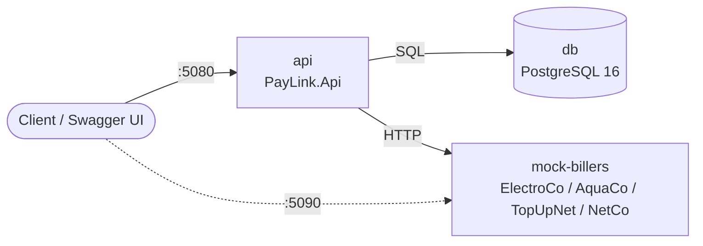
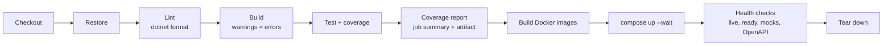
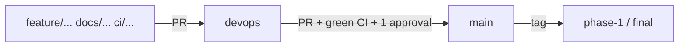

# DevOps foundation (Phase 1)

This page describes how PayLink is built, tested and run, and how the team works on the repository.

## 1. Repository layout

```
paylink/
├── src/
│   ├── PayLink.Api/                 API host (composition root): OpenAPI, health checks, module wiring
│   ├── PayLink.SharedKernel/        Types every module may use (IModule contract; Money later)
│   └── Modules/                     One project per module; modules never reference each other
│       ├── PayLink.Modules.Accounts            Accounts and Wallet
│       ├── PayLink.Modules.Catalog             Biller Catalog
│       ├── PayLink.Modules.Payments            Payment Processing
│       ├── PayLink.Modules.BillerIntegration   Biller Integration (adapters)
│       ├── PayLink.Modules.Fees                Fees and Commissions
│       ├── PayLink.Modules.Notifications       Notifications
│       ├── PayLink.Modules.Fraud               Fraud Checks (extra)
│       └── PayLink.Modules.Reconciliation      Reconciliation (extra)
├── mocks/PayLink.MockBillers/       Mock ElectroCo, AquaCo, TopUpNet, NetCo servers
├── tests/
│   ├── PayLink.Api.IntegrationTests/  Boots the real API in memory
│   └── PayLink.ArchitectureTests/     Enforces module boundaries
├── docs/                            Requirements, design, ADRs, prompt log
├── .github/                         CI workflow, PR and issue templates
├── docker-compose.yml               db + mock-billers + api
├── Directory.Build.props            Shared compiler/lint settings (warnings = errors)
├── Directory.Packages.props         All NuGet versions in one place
├── coverage.runsettings             Coverage collection settings
└── .editorconfig                    Code style used by the linter
```

## 2. Runtime view (docker compose)



| Service | Image | Host port | Health |
|---|---|---|---|
| `db` | `postgres:16-alpine` | 5432 | `pg_isready` |
| `mock-billers` | `paylink/mock-billers` | 5090 | `GET /health/live` |
| `api` | `paylink/api` | 5080 | `GET /health/live` (process), `GET /health/ready` (database) |

Start order is enforced: `api` waits until `db` and `mock-billers` report healthy.

## 3. CI pipeline (`.github/workflows/ci.yml`)

Runs on every push to any branch, on pull requests to `main`, and on `phase-*` / `final` tags.



| Stage | What fails the pipeline |
|---|---|
| Lint | Any formatting or code-style difference from `.editorconfig` |
| Build | Any compiler or analyzer warning |
| Test | Any failing test |
| Docker | An image that does not build, or a container that is not healthy within 180 s |
| Health checks | API not live, database not reachable, mock billers down, or no OpenAPI document |

Planned for Phase 2: a coverage gate (≥ 70% on domain logic) and a `deploy` job on `main` that runs on a self-hosted runner, re-runs the health checks, and rolls back to the previous image tag if they fail.

## 4. Branch protection and PR rules (set once in GitHub)

**Settings → Branches → Add branch ruleset** (or classic *Add rule*) for `main`:

1. **Require a pull request before merging**
   - Required approvals: **1** (a teammate other than the author)
   - Dismiss stale approvals when new commits are pushed
   - Require conversation resolution before merging
2. **Require status checks to pass**
   - Require branches to be up to date before merging
   - Required checks: `Build, lint, test` and `Docker images and stack smoke test`
     (they appear in the list after the workflow has run once)
3. **Block force pushes** and **restrict deletions**
4. Do not allow bypassing the above settings (include administrators)

Also: **Settings → General → Pull Requests**: allow squash merging and enable *Automatically delete head branches*.

Add the instructor and TAs under **Settings → Collaborators** (read access).

## 5. Team workflow

Two long-lived branches:

| Branch | Purpose | Who can push |
|---|---|---|
| `main` | Released, graded code. Tags `phase-1` and `final` are made here. | **Nobody directly.** Only merged pull requests from `devops`. |
| `devops` | Integration branch: all daily work lands here first. | Team members (directly or through feature-branch PRs). |



1. Pick or create an issue (use the **User story** template).
2. Create a branch from `devops`: `feature/us-09-pay-bill`, `fix/...`, `docs/...`, `ci/...`.
3. Commit small steps. For TDD features, commit in order: `test: ... (failing)`, then `feat: ...`, then `refactor: ...`.
4. If AI wrote more than half of a change, name it in the commit message, e.g. `feat: add fee strategies (AI: Claude)`.
5. Open a PR into `devops` (the template asks for tests and AI use). CI runs on it.
6. When `devops` is ready to deliver, open a PR from `devops` into `main`. CI must be green and a teammate must approve.

## 6. Submission checklist (`phase-1` tag)

- [ ] Fresh clone + `docker compose up --build` starts db, mock billers and api
- [ ] `http://localhost:5080/health/ready` returns `Healthy`
- [ ] Pipeline is green on `main`
- [ ] Branch protection on `main` is enabled (screenshot in the PDF report)
- [ ] `docs/requirements.md`, `docs/design/`, `docs/prompt-log.md` are committed
- [ ] `git tag phase-1 && git push origin phase-1`, and the pipeline is green on the tag
